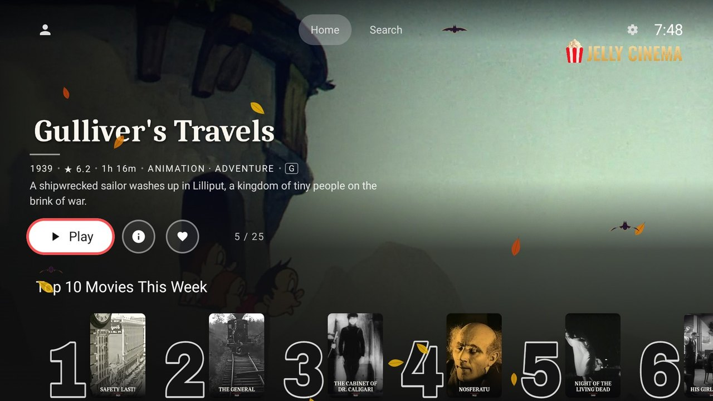
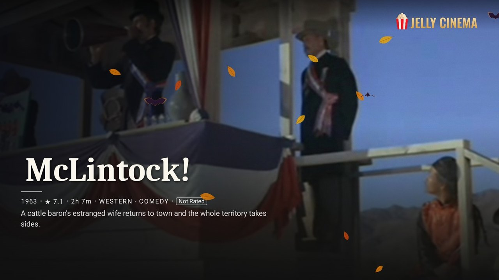
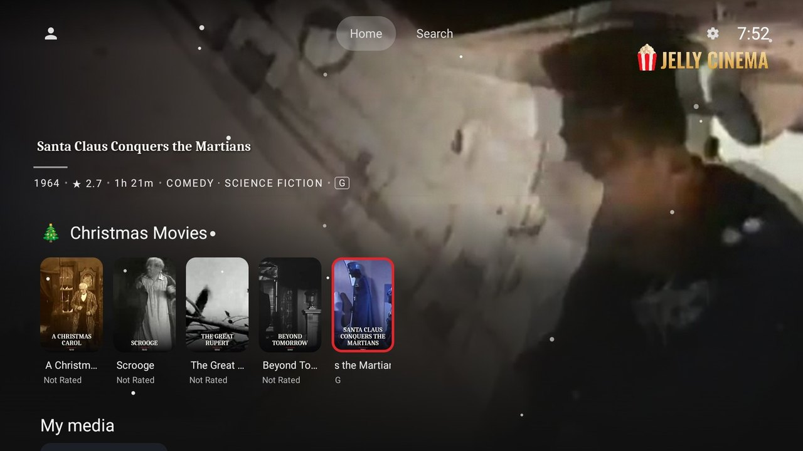
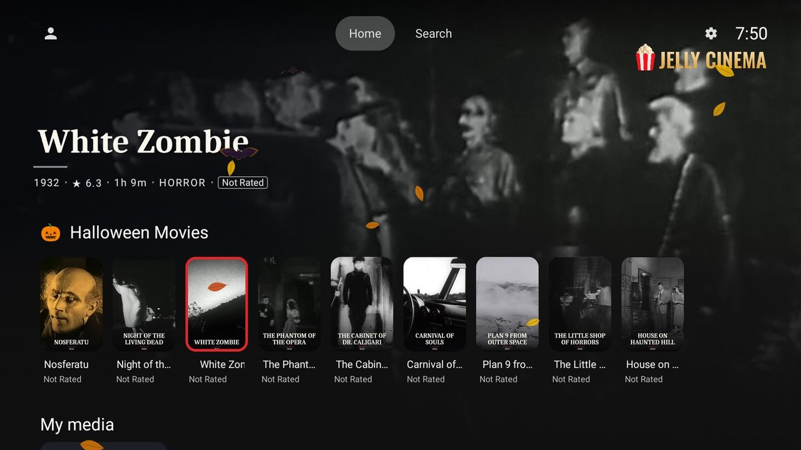
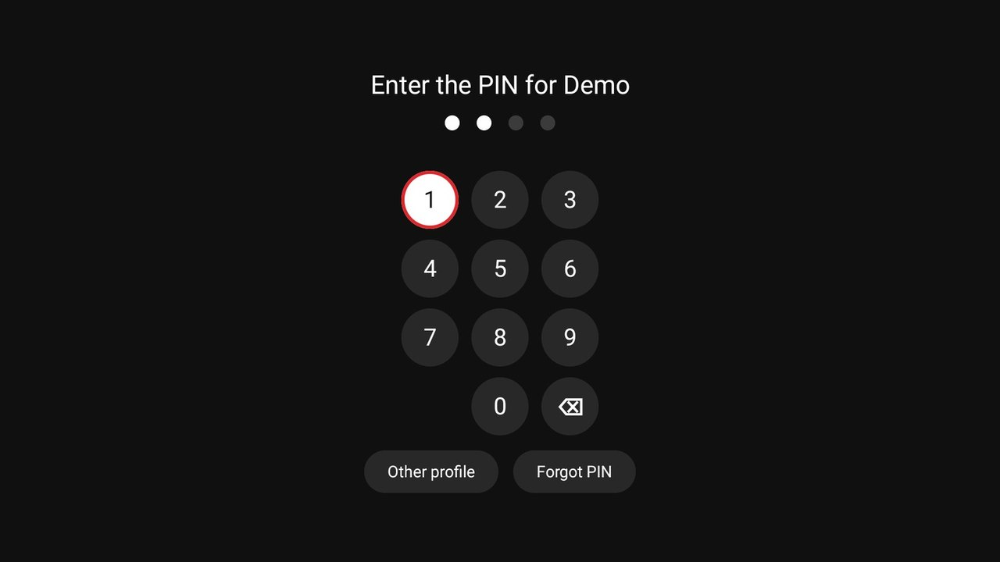
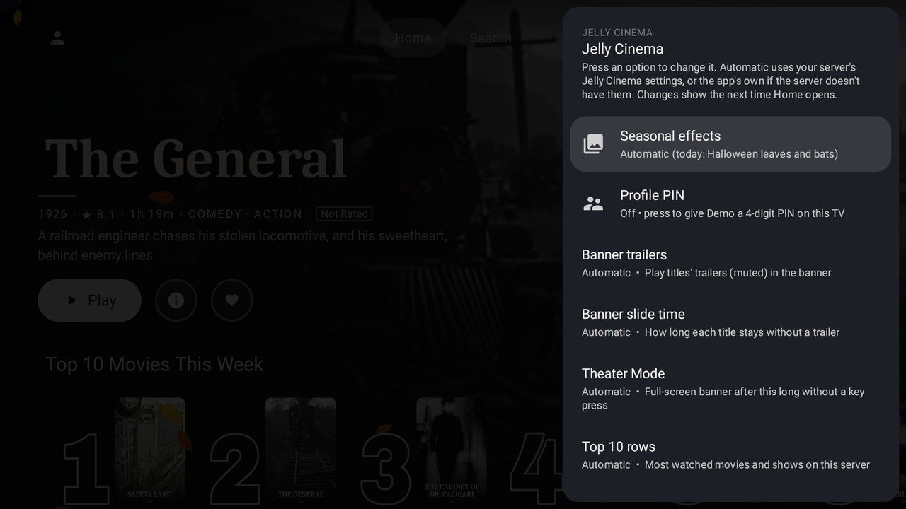

  

<h1 align="center">Jelly Cinema TV</h1>

  <b>Turn your TV into a movie theater for your own Jellyfin server.</b> 
  A big banner with trailers, Theater Mode, a Top 10 row, rows that change with the holidays, and profile PINs.
  For Android TV and Google TV. Free and open source.

  <a href="#install">Install</a> ·
  <a href="#features">Features</a> ·
  <a href="#settings">Settings</a> ·
  <a href="#jelly-cinema-on-the-web-too">Web plugin</a> ·
  <a href="#privacy-and-safety">Privacy</a> ·
  <a href="#price-and-support">Support the developer</a>

> [!TIP]
> **🌐 Using Jellyfin in a browser too?** The free **[Jelly Cinema plugin](https://github.com/techsystems23-llc/jellycinema-plugin)**
> brings the same home screen to Jellyfin's web interface. [More about the plugin ↓](#jelly-cinema-on-the-web-too)

## Features

**Hero banner.** Every title gets the full screen: its logo or name, year, rating, running time, genres and
story, with Play / Resume, More information and Favorite buttons. Muted trailers play behind it, from your own
trailer files or YouTube.

**Theater Mode.** Put the remote down and the menus fade away, so the banner and its trailer fill the whole
screen. Press any button to come back.

**Top 10 This Week.** Big outlined rank numbers next to the posters, for movies and shows, ranked from what
your household actually watched.

**Holidays that decorate themselves.** Halloween, Christmas, Easter and more: rows made from your own library
show up in season, with falling leaves, bats or snow. Nothing to set up.

**More rows.** Because You Watched, genre rows, Collections, Watch Again and weekend family Picks, next to
Jellyfin's own Continue Watching, Next Up and Recently Added.

**Profile PINs and Kids' Home.** Give any profile a 4-digit PIN, entered with a PIN pad made for the remote.
Accounts with a rating limit get Kids' Home automatically: bigger posters and no trailers.

**Made for the TV.** Continue Watching and Jelly Cinema rows on the Google TV home screen, "Hey Google" search,
and lighter effects on TV boxes with little memory. In English, Spanish, French and German.

**Works with any Jellyfin server**, with or without the Jelly Cinema plugin, and only ever shows what the
signed-in person is allowed to watch.

## Install

You need a TV or streaming box with Android TV or Google TV (Android 7.0 or newer) and a
[Jellyfin](https://jellyfin.org) server with your own movies and shows.

- **Google Play: $2.99, one time.** [Get it on Google Play](https://play.google.com/store/apps/details?id=com.techsystems23.jellycinema).
  The price is a convenience fee for installing and updating through Google Play. It's the same app, with no
  extra features.
- **Free from GitHub.** Download `jellycinema-tv.apk` from the
  [latest release](https://github.com/techsystems23-llc/jellycinema-tv/releases/latest) and install it on the TV,
  for example with the free *Downloader* app. This version updates itself.

Then open the app, pick your server (or type its address) and sign in, or use Quick Connect from the Jellyfin
app on your phone.

## Settings

**Settings → Jelly Cinema** on the TV has everything: trailers, slide time, Theater Mode, Top 10, Picks, holiday
rows, Because You Watched and genre rows, Collections, Watch Again, seasonal effects, profile PIN and Kids' Home.
Every option starts on *Automatic*, which uses the server's Jelly Cinema plugin settings when it has the plugin,
and the app's own defaults when it doesn't.

## Jelly Cinema on the web too

Want the same look in your browser? The free **[Jelly Cinema plugin](https://github.com/techsystems23-llc/jellycinema-plugin)**
brings the Jelly Cinema home screen to Jellyfin's web interface: the cinematic banner with trailers, Top 10 rows,
seasonal rows and effects, and the "Now Showing" sign-in screen. Install it from your Jellyfin Dashboard
(instructions in its README). The TV app works with or without it.

## Privacy and safety

- **No ads, no tracking, no analytics, and no account with us.** Your libraries and what you watch go only to
  your own Jellyfin server.
- **Only what each person may watch.** Every row and the banner respect each account's libraries and rating limit.
  An automatic test checks this on every change.
- **Crash reports only if you say yes**, and they go to your own server, not to us.
- Trailers from YouTube use YouTube's official player.

Full privacy policy: [techsystems23.com/apps/jelly-cinema/privacy](https://techsystems23.com/apps/jelly-cinema/privacy/)
(also in the app under Settings → About → Privacy policy).

## Price and support

The GitHub version is free. If you enjoy it, you can leave a tip from **Settings → Support the developer**,
which shows a QR code for [ko-fi.com/techsystems23](https://ko-fi.com/techsystems23). Tips are optional and don't
unlock anything. Buying the Google Play version also supports development.

Questions or problems: [open an issue](https://github.com/techsystems23-llc/jellycinema-tv/issues) or email
apps@techsystems23.com.

## Building

To build the app yourself or work on the code, see **[docs/BUILDING.md](docs/BUILDING.md)**.

## Licence, trademarks and warranty

Jelly Cinema TV is based on the official [Jellyfin Android TV app](https://github.com/jellyfin/jellyfin-androidtv)
and, like it, is licensed under the **GPL-2.0** (see `LICENSE` and `README.jellyfin.md`). Anyone who receives the
app is entitled to its complete source code under the same licence.

Jellyfin is a trademark of the Jellyfin project and YouTube is a trademark of Google LLC; both names are used only
to describe compatibility. Jelly Cinema TV is made by TechSystems23 LLC and is not affiliated with, made by or
endorsed by either. The app is provided "as is", without warranty of any kind (GNU GPL v2, sections 11 and 12).
Third-party artwork and font licences: see `NOTICE` and `licenses/`.
